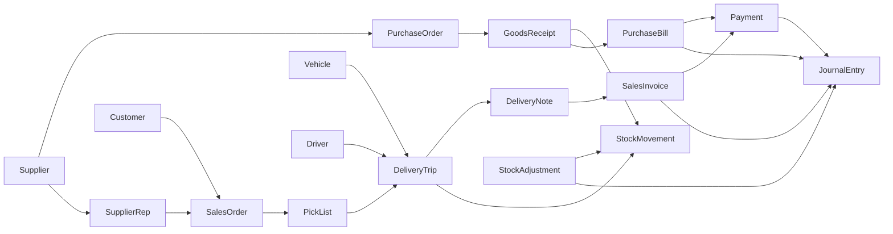
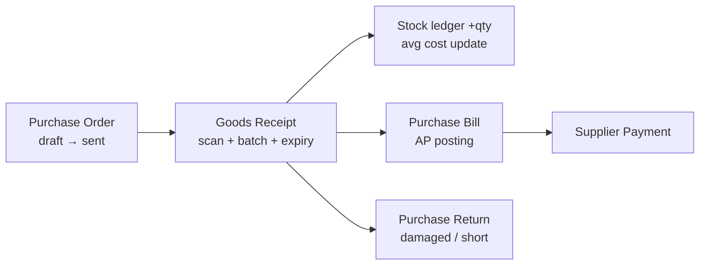
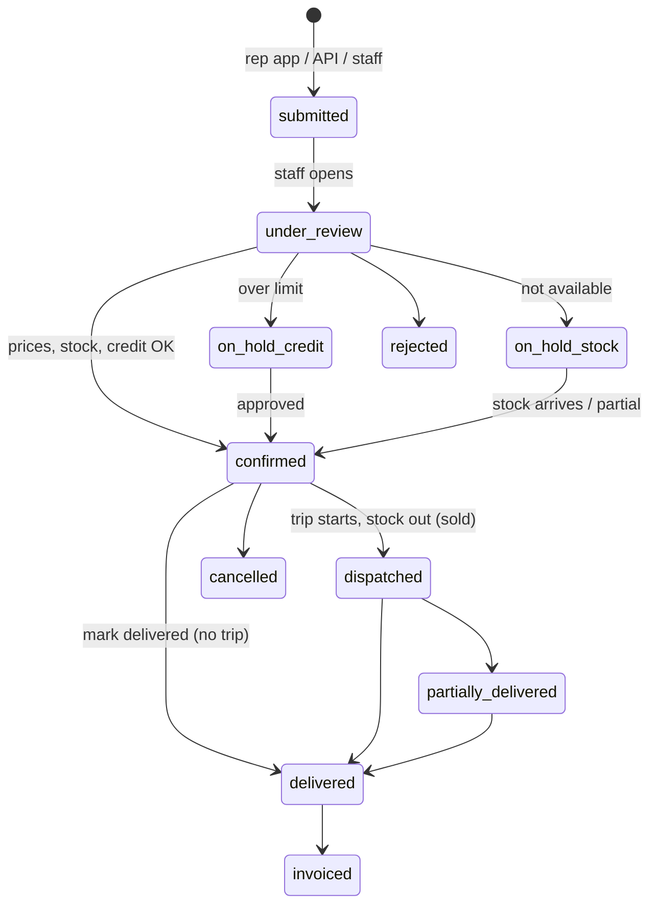

# Distribution Management SaaS — Complete Build Specification

As of: 2026-09-22

> **How to use this file:** give the whole document to the AI/developer that will build the system. Section 14 contains the handoff prompt to paste first. Section 15 lists the decisions still open.

---

## 1. Overview and assumptions

Build a multi-tenant SaaS (Django + DRF backend, React frontend, mobile-ready API) for city-level distribution companies that buy hair-colour and similar products in bulk from one or more manufacturers, store them in one or more warehouses, and deliver against orders raised by the manufacturers' sales reps. The product tracks every unit in and out, supports barcodes, manages inventory and losses, and runs a full double-entry accounting system with a 4-level chart of accounts.

**Business flow in one line:** Manufacturer → (Purchase) → Company warehouse(s) → (Sales order from manufacturer's rep, confirmed by company staff) → Dispatch on a trip (stock out = sold) → Delivery by company driver + manufacturer rep → Retailer/customer → Payment collection by staff or rep → Accounts.

**Three user populations**

| Population | Where they work | Access |
| --- | --- | --- |
| Platform Admin (you / your team) | Platform admin panel (React, custom — not Django admin) | Plans, tenants, subscriptions, payments, global settings |
| Company (tenant) users | Company app (React web; later mobile) | Owner creates roles, users, and all operations |
| External users (manufacturer sales reps, retailers) | Mobile app, portal, or their own systems via the public Order API | Submit orders only for the companies that have granted them access |

**Assumptions (change any of these and the spec still holds)**

- Currency: single base currency per tenant (default PKR), decimal(18,4) storage, 2-decimal display. Multi-currency is out of scope for v1 but the schema keeps a `currency` field on money documents.
- Tax: dynamic tax types defined by the Owner, up to two taxes per line (see §5.1 and §8.4).
- Fiscal year: configurable start month per tenant (default July).
- Units: products can have multiple packaging levels (piece → box → carton) with conversion factors; stock is stored in base unit.
- Batches/expiry: hair colour has shelf life, so batch (lot) number and expiry are supported and optional per product.
- Plan billing is manual: platform admin records payments (bank transfer, cash, cheque) and renews/upgrades manually. No payment gateway in v1, but the design leaves a hook for one.
- One tenant = one company. A company can have many warehouses, many suppliers (manufacturers), many customers.
- Language: English UI, RTL/Urdu translation-ready (i18n keys), not translated in v1.
- Hosting: production on the customer's own VPS (see §10.5).

**Non-goals for v1:** payroll, fixed-asset depreciation schedules, manufacturing/BOM, route optimisation, multi-currency, e-commerce storefront.

---

## 2. Actors, roles and permission model

Use Django's built-in `User`, `Group` and `Permission` models, extended with a tenant scope. Every role is a Django `Group` that belongs to a tenant; every permission check is `has_perm(codename)` **and** `object.tenant == request.tenant`.

### 2.1 Actor types

| Actor | Created by | Typical role |
| --- | --- | --- |
| Platform Admin | Seed command / another platform admin | Runs the SaaS. `is_platform_admin=True`, no tenant. |
| Owner | Platform Admin (exactly one per company at creation; ownership transferable later) | Full access inside the tenant; creates roles and users. Cannot be deleted by other tenant users. |
| Tenant staff user | Owner or any user with `users.manage` | Manager, Accountant, Warehouse Keeper, Store Keeper, Cashier, Driver, Sales Officer, Auditor, etc. — all defined by the Owner. |
| External user (Manufacturer Sales Rep) | Owner/staff invites by phone or email; the rep accepts | Belongs to a *Supplier* record, can be linked to several tenants. Can only submit and view orders in the territory/customers allowed. |
| External user (Retailer / Customer) | Optional, v2 | Views own orders, invoices, ledger; can self-order if allowed. |
| API client (system-to-system) | Owner or staff with `api.manage` | Key pair for the manufacturer's ERP to push orders via the public API. |

### 2.2 User model

```
User (extends AbstractUser)
  id (UUID), email (unique, optional), phone (unique, E.164), full_name
  user_type: PLATFORM_ADMIN | TENANT | EXTERNAL
  is_active, mfa_enabled, last_login_ip, locale, timezone, avatar
TenantMembership
  user, tenant, is_owner, status (active/suspended), groups (M2M to Group), joined_at
  -> one user can belong to many tenants (needed for reps and for your support staff)
Group (Django) + GroupProfile
  tenant (null = platform-level), description, is_system (Owner role is system, non-deletable), role_type [internal, external]
```

### 2.3 Permission catalogue (Django codenames)

Define custom permissions on each model in `Meta.permissions` plus module-level "virtual" permissions on a `Module` model. Frontend reads `/api/me/permissions` and hides what is not allowed. Suggested codenames (prefix = app):

| Module | Permissions |
| --- | --- |
| users | view_user, add_user, change_user, deactivate_user, reset_password, manage_roles, view_activity_log |
| catalog | view/add/change/archive product, manage_category, manage_brand, manage_uom, manage_price_list, print_barcode |
| suppliers | view/add/change supplier, manage_supplier_reps, view_supplier_ledger |
| customers | view/add/change customer, set_credit_limit, block_customer, view_customer_ledger |
| purchasing | view/add/change/approve/cancel purchase_order, receive_goods (GRN), post_purchase_bill, add_purchase_return |
| sales | view/add/change/confirm/cancel sales_order, override_price, override_discount, approve_credit_hold |
| delivery | create_delivery, assign_driver, start_trip, complete_delivery, record_delivery_return, view_all_trips, manage_vehicles, manage_drivers |
| inventory | view_stock, transfer_stock, approve_transfer, adjust_stock, record_wastage, approve_adjustment, run_stock_count, approve_stock_count, view_valuation |
| accounting | view_coa, manage_coa, add_journal, post_journal, reverse_journal, manage_payments, reconcile_bank, close_period, view_financial_reports, manage_tax |
| cash | view_cash, receive_payment, make_payment, approve_expense, manage_petty_cash, settle_rep_collection |
| reports | view_operational_reports, view_financial_reports, export_reports |
| settings | manage_company, manage_branding (only when platform admin has enabled branding), manage_warehouses, manage_numbering, manage_notifications, manage_api_keys, manage_integrations |
| external (rep roles) | submit_order, cancel_own_order, view_own_orders, view_assigned_customers, add_customer_request, view_customer_outstanding, view_prices, view_stock_exact, view_stock_bands, view_delivery_status, record_collection, view_own_collections, view_targets — the Owner ticks exactly what each rep role can see and do |

Data-scoping rules (enforced in querysets, not just permissions):

- **Warehouse scope:** a user can be limited to one or more warehouses (`UserWarehouseAccess`). Warehouse Keeper only sees own warehouse stock and documents.
- **Supplier scope:** an external rep sees only the supplier they belong to and the customers/territory assigned.
- **Amount thresholds:** optional per-role approval limits (e.g. a Manager can approve stock adjustments up to X value; above that, Owner).

### 2.4 Suggested default roles (seeded as templates the Owner can clone or edit)

Owner (system) · Manager · Accountant · Cashier · Warehouse Keeper · Store Keeper · Sales Coordinator (confirms rep orders) · Driver · Auditor (read-only) · Manufacturer Rep (external).

### 2.5 Auth

- JWT (access 15 min, refresh 7–30 days, rotating) via `djangorestframework-simplejwt`; refresh stored HttpOnly for web, secure storage for mobile.
- Login by email or phone + password; OTP via SMS/email for password reset, rep invitation acceptance, and optional MFA.
- Session/device list with revoke; force logout on role change.
- Tenant resolution: `X-Tenant-ID` header or subdomain; membership verified on every request.

---

## 3. SaaS platform admin (custom panel, not Django admin)

The platform admin panel is its own React app (or a separate route tree) backed by `/api/platform/...` endpoints available only to `is_platform_admin` users.

### 3.1 Plans and pricing

- Create/edit/archive plans: name, code, description, price, billing cycle (monthly, quarterly, yearly, custom days), trial days, currency, sort order, is_public.
- Plan limits and feature flags (stored as JSON, checked server-side): max users, max warehouses, max products, max monthly orders, max storage (MB), API access on/off, external rep portal on/off, barcode module, multi-supplier, advanced accounting, reports export, custom roles count, data retention months, branding (white-label). Branding is off unless the platform admin enables it on the plan or as a per-tenant override; only then does the Owner see Settings → Branding.
- Plan versions: editing a plan creates a new version; existing subscriptions keep their version until renewed (grandfathering).
- Add-ons: extra users, extra warehouse, extra storage, extra reps, priced per unit.
- Coupons / discounts: percentage or fixed, validity window, usage limit, applicable plans.

**Recommended starting plans** (limits are what a city distributor actually hits; prices are indicative placeholders to replace with your own):

| Limit / feature | Starter | Growth | Pro | Enterprise |
| --- | --- | --- | --- | --- |
| Users | 5 | 15 | 40 | Unlimited |
| Warehouses | 1 | 3 | 10 | Unlimited |
| Suppliers (manufacturers) | 1 | 3 | Unlimited | Unlimited |
| External reps | 5 | 25 | 100 | Unlimited |
| Products (variants) | 500 | 3,000 | 15,000 | Unlimited |
| Sales orders / month | 500 | 3,000 | 15,000 | Unlimited |
| Storage (attachments) | 2 GB | 10 GB | 50 GB | Custom |
| Custom roles | 3 | 10 | Unlimited | Unlimited |
| Barcode & label printing | Yes | Yes | Yes | Yes |
| External Order API + webhooks | No | Yes, 60 req/min | Yes, 300 req/min | Yes, custom |
| Advanced accounting (bank rec, cost centres, budgets) | No | Yes | Yes | Yes |
| Branding / white-label | No | No | Yes | Yes |
| Report scheduling & Excel export | No | Yes | Yes | Yes |
| Backup retention | 7 days | 30 days | 90 days | Custom |
| Support | Email | Email + chat | Priority | Dedicated |
| Indicative price / month (PKR) | 5,000 | 12,000 | 25,000 | Custom |

Add-ons priced per unit: +5 users, +1 warehouse, +10 GB storage, +25 reps. Trial: 14 days on Growth.

### 3.2 Tenants (companies)

- Create company: legal name, display name, slug/subdomain, address, phone, tax registration numbers, logo, fiscal year start, base currency, timezone.
- Create the **Owner** user at the same time (name, email/phone, temporary password or invite link). Only one owner; transfer ownership action.
- Status lifecycle: Trial → Active → Past Due → Suspended (read-only) → Cancelled → Archived (data export then purge after N days).
- Suspend/reactivate with reason; suspended tenants can log in but only see a billing notice and can export data.
- Impersonate ("log in as owner") with audit log entry and visible banner; time-limited, can be disabled by tenant.
- Reset owner password / unlock account / revoke all sessions.
- Per-tenant overrides: override a plan limit or feature flag (e.g. branding) for one tenant without changing the plan.
- Tenant usage view: users, warehouses, products, orders this month, storage used, API calls, last activity.
- Data export (full JSON/CSV zip) and delete tenant (two-step confirm, soft delete then purge job).

### 3.3 Subscriptions

- Assign plan on creation; start date, end date, auto-computed from cycle.
- **Manual renew:** pick period, record payment (or mark unpaid), new end date; option to extend from old end date or from today.
- **Upgrade / downgrade:** immediate or at period end; pro-rata credit calculation shown (editable) and stored; downgrade blocked if tenant exceeds new limits until they reduce usage (show what is over).
- Grace period days per plan; automatic status change to Past Due then Suspended via daily Celery job, with email/SMS reminders at −7, −3, 0, +3 days (templates editable).
- Trial management: extend trial, convert trial.
- Subscription history timeline per tenant (every change with actor, timestamp, reason).

### 3.4 Payments and invoicing

- Record payment: amount, currency, method (bank transfer, cash, cheque, JazzCash/Easypaisa, card, other), reference no., date, attach receipt image/PDF, note.
- Generate platform invoice (PDF) per period with sequential numbering; credit notes for refunds/pro-rata.
- Full payment history: filter by tenant, plan, method, date range, status (paid, partial, pending, refunded, failed); export CSV.
- Outstanding balances dashboard: who is past due, ageing buckets.
- Refund record (manual) with reason.
- Gateway hook: abstract `PaymentProvider` interface so Stripe/local gateways can be plugged in later without schema change.

### 3.5 Platform dashboard and analytics

MRR/ARR, active tenants, trials, churn this month, revenue by plan, payments received this month, past-due amount, top tenants by orders, API usage, error rate, background job health.

### 3.6 Platform users and security

- Platform admin roles: Super Admin, Billing Admin, Support (read + impersonate), Viewer. Uses the same Django Groups at platform level.
- MFA required for platform admins; IP allow-list optional.
- Full audit log of every platform action (who, what, before/after JSON, IP).

### 3.7 Communication and support

- Announcements / in-app banners to all or selected tenants (maintenance, new features) with schedule.
- Email/SMS/push template editor (invite, renewal reminder, receipt, suspension) with variables and preview.
- Support tickets inbox (tenant users can open tickets from the app) with status, priority, assignment, replies, attachments. Can be a v2 item.
- Notification log (every email/SMS/push sent, delivery status).

### 3.8 System settings

- Global defaults: default plan for new tenants, trial length, currencies list, tax templates, default chart of accounts template (see §8), default role templates, product category templates.
- Feature flags (global and per tenant) for gradual rollout — branding lives here.
- Integrations config: SMS provider, email provider (SMTP/SES), push (FCM), object storage, backup schedule.
- Backup and restore per tenant (trigger backup, list backups, restore to staging).
- API rate limits per plan; API key overview across tenants.
- Health/monitoring page: DB size, queue length, failed jobs with retry, scheduled jobs list (renewal check, reminders, backups, report caches).
- Legal: terms/privacy version management; tenants must accept on first login after change.

### 3.9 Platform data model

```
Plan(id, code, name, description, price, currency, billing_cycle, cycle_days, trial_days, limits JSON, features JSON, is_public, is_archived, version, parent_plan)
AddOn(id, code, name, unit_price, unit_label)
Coupon(id, code, type, value, valid_from, valid_to, max_uses, used_count, plans M2M)
Tenant(id, slug, legal_name, display_name, status, base_currency, fiscal_year_start_month, timezone, settings JSON, limit_overrides JSON, feature_overrides JSON, branding JSON, created_by, suspended_at, suspended_reason, deleted_at)
Subscription(id, tenant, plan, plan_version, status, start_date, end_date, trial_end, grace_days, auto_status_change, cancelled_at, notes)
SubscriptionAddOn(subscription, addon, quantity)
SubscriptionEvent(id, subscription, event_type[created, renewed, upgraded, downgraded, suspended, reactivated, cancelled, trial_extended, limit_override], from JSON, to JSON, actor, at, reason)
PlatformInvoice(id, tenant, subscription, number, period_start, period_end, subtotal, discount, tax, total, status, pdf_file)
PlatformPayment(id, tenant, invoice, amount, currency, method, reference, paid_at, recorded_by, receipt_file, note, status)
PlatformRefund(id, payment, amount, reason, recorded_by, at)
Announcement(id, title, body, audience, starts_at, ends_at, dismissible)
MessageTemplate(id, key, channel[email, sms, push, whatsapp], subject, body, variables)
NotificationLog(id, tenant, user, channel, template_key, to, status, provider_response, sent_at)
SupportTicket / TicketMessage
PlatformAuditLog(id, actor, action, target_type, target_id, before JSON, after JSON, ip, at)
FeatureFlag(key, enabled, tenants M2M)
```

---

## 4. Tenant module map (what every company gets)

| Module | Key screens / features |
| --- | --- |
| Dashboard | Today's orders, dispatched/in-delivery, low stock, expiring batches, cash position, cash with reps, receivables/payables due, sales vs last period |
| Company setup | Profile, logo, tax numbers, fiscal year, currency, document numbering (prefix + sequence per document type), print templates, notification preferences. Branding (visible only when enabled by the platform admin): app display name, logo/favicon, primary and accent colours, login-page image, document header/footer and footer text, email sender name, PDF theme; custom domain in v2 |
| Users & roles | Users list, invite, deactivate, role builder (permission checkboxes grouped by module, separate builder for external rep roles), warehouse scope, approval limits, activity log per user, active sessions |
| Suppliers (manufacturers) | Supplier profile, contacts, sales reps (external users) with rep role, payment terms, ledger, product catalogue mapping, price agreements |
| Product catalogue | Products with variants (shade/colour code, size), brand, category tree, UoM + packaging levels, barcodes (multiple per product incl. packaging-level barcodes), cost/price, tax class, min/max stock, reorder level, batch/expiry flag, images |
| Price lists & discounts | Multiple price lists (retail, wholesale, scheme), customer-group pricing, quantity slabs, scheme/promotion (buy X get Y, % off) with date ranges |
| Customers (retailers/salons) | Profile, territory/route, credit limit, credit days, price list, tax class override, GPS location, contacts, ledger, documents |
| Purchasing | Purchase order → Goods Receipt Note (with barcode scan, batch, expiry, damaged qty) → Purchase bill → Supplier payment; purchase returns; landed cost allocation (freight) |
| Sales orders | Rep-submitted orders inbox (confirm/edit/reject), staff-entered orders, credit check, stock availability check, partial allocation, backorders, order status timeline, "Mark delivered" action |
| Delivery & dispatch | Vehicles and drivers registry, pick list (by warehouse), packing, delivery challan, trip sheet (driver + vehicle + rep + assigned orders), route stops, proof of delivery (signature/photo), delivery returns (rejected items), cash collected on delivery |
| Invoicing & receivables | Sales invoice per delivery/order, credit notes, receipts (cash/bank/cheque) by any authorised staff, rep collections and settlements, cheque register (PDC), customer statements, ageing, reminders |
| Inventory | Stock by warehouse/bin/batch, stock ledger (every movement), transfers between warehouses (request → approve → dispatch → receive), adjustments (damage, expiry, theft, lost, sample, promotional, count variance) with reason codes and approval, stock count sessions (full/cycle) with scanner, reservations, valuation (weighted average) |
| Barcode & labels | Scan-to-search everywhere, label printing (product, batch, shelf/bin), scanner-mode screens for GRN, picking, loading, transfer, count |
| Accounting | 4-level COA, journals, auto-postings from every document, cash/bank books, bank reconciliation, expenses (with categories and approval), petty cash, tax ledger per tax type, period close/lock, opening balances, cost centres (warehouse/route/vehicle) |
| Reports | Operational (sales, purchase, stock, delivery, rep performance) and financial (trial balance, P&L, balance sheet, cash flow, ledgers, ageing, tax). Export PDF/Excel/CSV, schedule by email |
| Notifications | Push notifications to the mobile app (FCM/APNs) for reps and staff, in-app inbox, plus email/SMS/WhatsApp (provider abstract) for: new rep order, order confirmed/rejected, order dispatched, delivery assigned, delivery completed, low stock, expiry, payment received, rep settlement due, approvals pending |
| External rep portal / app | Mobile-first: my customers, place order (catalogue, stock visibility per role, prices per role), order status, delivery schedule, my collections and settlements, simple sales target view |
| Public API & integrations | API keys, webhooks (order.created, order.confirmed, order.dispatched, delivery.completed, invoice.created, payment.received), import/export (CSV for products, customers, opening stock, opening balances) |
| Documents & attachments | File uploads on any document (receipts, POD photos, cheques, vehicle/driver documents), object storage |
| Audit & activity | Every create/update/delete/status change with before/after diff; document-level history tab |
| Subscription (tenant view) | Current plan, limits and usage, invoices and payment history from platform, contact support |

---

## 5. Data model (tenant side)

All tenant tables carry `tenant_id` (FK, indexed) plus `created_at, created_by, updated_at, updated_by, deleted_at` via an abstract `TenantModel`. IDs are UUIDv7. Money = `DecimalField(18,4)`, quantities = `DecimalField(18,3)` in base UoM.

### 5.1 Master data

```
Warehouse(tenant, code, name, address, type[main, sub, van, quarantine], vehicle (nullable, for van type), is_active, manager)
Bin(warehouse, code, name)                                  # optional shelf/rack
Supplier(tenant, code, name, contacts, address, tax_no, payment_terms_days, account (FK COA), is_active)
SupplierRep(supplier, user (EXTERNAL), name, phone, territory, is_active, role (Group of type external — controls what the rep sees: stock exact/bands/none, prices, customer outstanding, collections))
Customer(tenant, code, name, type[retailer, salon, wholesaler, other], phone, address, gps, territory, route, price_list, credit_limit, credit_days, tax_class_override, account (FK COA), assigned_reps M2M, is_blocked, opening_balance)
Territory(tenant, name, parent)   Route(tenant, name, territory, day_of_week)
Brand(tenant, supplier, name)   Category(tenant, name, parent)  # tree
UnitOfMeasure(tenant, code, name)
Product(tenant, sku, name, brand, category, supplier, base_uom, is_batch_tracked, is_expiry_tracked, shelf_life_days, tax_class, cost_price, min_stock, max_stock, reorder_qty, status, images, attributes JSON)
ProductVariant(product, sku, name, attributes JSON e.g. shade_code, size_ml, cost_price, sale_price)  # use variant as the stock-keeping unit; a simple product has one default variant
Packaging(variant, uom, qty_in_base, barcode)                # piece=1, box=12, carton=144
Barcode(tenant, variant, packaging (null=base), code, type[EAN13, CODE128, QR, internal], is_primary)
PriceList(tenant, name, currency, is_default, valid_from, valid_to)
PriceListItem(price_list, variant, packaging, min_qty, price)
Scheme(tenant, name, type[percent, amount, free_qty], rules JSON, valid_from, valid_to, customers/groups, products)
TaxType(tenant, code, name, kind[sales_tax, further_tax, withholding, other], applies_to[sales, purchases, both], account (FK COA), is_active)   # dynamic list; Owner defines
TaxRate(tax_type, name, rate_pct, valid_from, valid_to)
TaxClass(tenant, name, tax1 (TaxType, nullable), tax2 (TaxType, nullable), tax2_compounds_on_tax1: bool)   # every product/customer gets a tax class; up to two taxes per line
# document lines store tax1_type, tax1_rate, tax1_amount, tax2_type, tax2_rate, tax2_amount; customer/supplier can override the class (e.g. unregistered → further tax)
NumberSequence(tenant, document_type, prefix, next_number, padding, reset[never, yearly])
```

### 5.2 Purchasing

```
PurchaseOrder(tenant, number, supplier, warehouse, date, expected_date, status[draft, sent, partially_received, received, cancelled], currency, subtotal, discount, tax, freight, total, notes)
PurchaseOrderLine(po, variant, packaging, qty_ordered, qty_received, unit_price, discount, tax1..., tax2..., line_total)
GoodsReceipt(tenant, number, po (nullable for direct receipt), supplier, warehouse, date, status[draft, posted, cancelled], supplier_challan_no, received_by)
GoodsReceiptLine(grn, po_line, variant, packaging, qty_accepted, qty_damaged, qty_short, batch_no, mfg_date, expiry_date, bin, unit_cost, landed_cost_share)
PurchaseBill(tenant, number, supplier, grn M2M, bill_date, due_date, supplier_invoice_no, subtotal, tax1_total, tax2_total, total, status[draft, posted, partially_paid, paid, cancelled], journal)
PurchaseReturn(tenant, number, supplier, warehouse, date, reason, lines[variant, batch, qty, unit_cost], status, journal)
LandedCost(grn, type[freight, customs, other], amount, allocation[by_qty, by_value])
```

### 5.3 Sales and delivery

```
SalesOrder(tenant, number, customer, supplier (which manufacturer's rep), rep (SupplierRep, nullable), source[rep_app, api, staff, portal], warehouse, order_date, requested_delivery_date, status[submitted, under_review, confirmed, on_hold_credit, on_hold_stock, dispatched, partially_delivered, delivered, invoiced, cancelled, rejected], dispatched_at, delivered_at, trip (nullable), price_list, subtotal, discount, scheme_discount, tax1_total, tax2_total, total, external_ref, rejection_reason, confirmed_by, confirmed_at)
SalesOrderLine(order, variant, packaging, qty_ordered, qty_allocated, qty_dispatched, qty_delivered, unit_price, discount_pct, tax1..., tax2..., line_total, free_qty)
StockReservation(order_line, warehouse, batch, qty, expires_at)
PickList(tenant, number, warehouse, orders M2M, status[open, picking, picked], picker)
PickListLine(picklist, order_line, variant, batch, bin, qty_to_pick, qty_picked, scanned_at)
Vehicle(tenant, reg_no, make_model, type, capacity_cartons, owner_type[company, rented], insurance_expiry, fitness_expiry, tracker_id, is_active, documents)
Driver(tenant, user (nullable — a driver may have no login), name, phone, cnic, license_no, license_expiry, default_vehicle, is_active, documents)
VehicleLog(vehicle, trip, odometer_start, odometer_end, fuel_amount, expense)   # optional per-trip running cost
DeliveryTrip(tenant, number, warehouse, date, driver (Driver), vehicle, rep (SupplierRep, nullable), orders (via DeliveryNote), status[planned, loading, out_for_delivery, completed, closed], stops_count, cash_collected, notes)
DeliveryNote(tenant, number, trip (nullable for "mark delivered" without trip), order, customer, sequence, status[loaded, delivered, partially_delivered, failed, returned], delivered_at, receiver_name, signature_file, photo_file, gps, failure_reason, cash_collected, collected_by)
DeliveryNoteLine(delivery_note, order_line, variant, batch, qty_loaded, qty_delivered, qty_returned, return_reason)
SalesInvoice(tenant, number, customer, order, delivery_note, date, due_date, subtotal, discount, tax1_total, tax2_total, total, paid_amount, status[draft, posted, partially_paid, paid, overdue, cancelled], journal)
SalesInvoiceLine(...)
SalesReturn / CreditNote(tenant, number, customer, invoice, date, lines[variant, batch, qty, unit_price, reason, restock:bool, condition[good, damaged]], journal)
RepCollection(tenant, number, rep, customer, date, amount, method, allocations[invoice, amount], status[held_by_rep, settled], journal)
RepSettlement(tenant, number, rep, date, amount, received_by, cash_account, collections M2M, journal)
```

### 5.4 Inventory

```
Batch(tenant, variant, batch_no, mfg_date, expiry_date, supplier, grn_line)
StockLevel(tenant, warehouse, bin, variant, batch, qty_on_hand, qty_reserved, avg_cost)   # materialised, updated inside a DB transaction with SELECT ... FOR UPDATE
StockMovement(tenant, warehouse, bin, variant, batch, qty (+/-), unit_cost, movement_type[grn, purchase_return, sale_dispatch, sales_return, transfer_out, transfer_in, adjustment, wastage, count_variance, opening], reference_type, reference_id, occurred_at, performed_by, note)   # immutable ledger; StockLevel = SUM(StockMovement)
StockTransfer(tenant, number, from_warehouse, to_warehouse, status[requested, approved, dispatched, in_transit, received, cancelled], requested_by, approved_by, lines[variant, batch, qty_sent, qty_received, qty_lost])
StockAdjustment(tenant, number, warehouse, type[increase, decrease], reason (ReasonCode), status[draft, pending_approval, approved, rejected], lines[variant, batch, qty, unit_cost, value], approved_by, journal)
ReasonCode(tenant, code, name, category[damage, expiry, theft, lost, sample, promotion, count, correction, transit_damage, other], expense_account (FK COA), requires_approval, requires_photo)
StockCount(tenant, number, warehouse, type[full, cycle], status[open, counting, review, posted], scope (categories/bins), started_by, posted_by)
StockCountLine(count, variant, batch, bin, system_qty, counted_qty, variance, counted_by, scanned)
```

### 5.5 Accounting

```
Account(tenant, code, name, level[1..4], parent, type[asset, liability, equity, income, expense], subtype, is_group, is_active, is_system, currency, opening_balance, allow_manual_posting)
JournalEntry(tenant, number, date, type[manual, auto], source_type, source_id, status[draft, posted, reversed], memo, posted_by, posted_at, reversed_by_entry, period)
JournalLine(entry, account, debit, credit, description, partner_type[customer, supplier, rep, employee], partner_id, cost_centre, tax_type)
FiscalYear(tenant, start, end, status)  AccountingPeriod(fiscal_year, month, status[open, closed], closed_by)
CostCentre(tenant, code, name)   # warehouse, route, vehicle, department
BankAccount(tenant, name, bank, account_no, account (FK COA), opening_balance)
CashAccount(tenant, name, account (FK COA), custodian)
Payment(tenant, number, direction[in, out], partner_type, partner_id, date, amount, method[cash, bank_transfer, cheque, online, adjustment], bank_account/cash_account, collected_by, cheque_no, cheque_date, cheque_status[pending, deposited, cleared, bounced], reference, journal, allocations[invoice/bill, amount])
Expense(tenant, number, date, category (FK COA expense), amount, tax, paid_from, vendor, cost_centre, status[draft, submitted, approved, paid, rejected], receipt_file, journal)
BankStatementLine(bank_account, date, description, amount, matched_payment, reconciled)
OpeningBalanceBatch(tenant, date, lines[account, debit, credit], posted)
PostingRule(tenant, document_type, role[inventory, in_transit, cogs, ar, ap, sales, sales_return, discount, tax1_out, tax2_out, tax1_in, tax2_in, grni, rep_clearing, ...], account)
```

### 5.6 System

```
AuditLog(tenant, actor, action, model, object_id, before JSON, after JSON, ip, user_agent, at)
Attachment(tenant, model, object_id, file, name, size, uploaded_by)
Notification(tenant, user, type, title, body, data JSON, read_at)
DeviceToken(user, platform[ios, android, web], token, last_seen)
NotificationPreference(user, type, push:bool, email:bool, sms:bool)
ApiKey(tenant, name, key_prefix, hashed_key, scopes JSON, supplier (nullable), rate_limit, expires_at, last_used_at, is_active)
WebhookEndpoint(tenant, url, secret, events JSON, is_active)  WebhookDelivery(endpoint, event, payload, status, attempts, last_error)
ImportJob(tenant, type, file, status, rows_total, rows_ok, rows_failed, error_file)
```

### 5.7 Entity relationship (core)



Every operational document that changes value produces a `StockMovement` (quantity) and/or a `JournalEntry` (money), and both point back to the source document.

---

## 6. Core workflows

### 6.1 Purchase (stock in)



1. Staff raise a PO (or receive directly without PO). PO can be emailed/PDF'd to the supplier.
2. GRN: scan each barcode or pick from PO lines; enter accepted, damaged and short quantities; batch no. and expiry mandatory when the product is tracked; landed cost (freight) optional.
3. Posting the GRN inserts `StockMovement(+qty)` per line, updates weighted-average cost, and posts `Dr Inventory / Cr GRNI (Goods Received Not Invoiced)`.
4. Purchase bill matches GRN(s): `Dr GRNI, Dr Input Tax 1, Dr Input Tax 2 / Cr Accounts Payable (supplier sub-ledger)`. Variance between GRN cost and bill goes to Purchase Price Variance.
5. Payment: `Dr Accounts Payable / Cr Bank or Cash`, allocated to bills (FIFO by default, editable). Withholding tax on the payment if the supplier's tax class requires it.

### 6.2 Sales order (rep submits, staff confirms)



- Rep-submitted orders land in an **Orders inbox**; staff can edit quantities/prices (with `override_price`), split, merge, or reject with reason. The rep is notified (push) on every status change.
- On confirm: credit check (outstanding + this order vs credit limit and overdue days), stock availability per warehouse, reservation of stock (optional setting), scheme/discount application, tax calculation (Tax 1 + Tax 2 per line), numbering.
- Staff-entered orders can be confirmed in one step if the user has `confirm_sales_order`.
- Backorders: unfulfilled quantity stays open; setting to auto-cancel after N days.

### 6.3 Dispatch and delivery

1. Build a pick list from confirmed orders (by warehouse, route, date). Scanner mode: scan bin/batch/product, enter qty; FEFO (first-expiry-first-out) suggestion for batches.
2. Create a **trip**: pick a driver (from Driver records), a vehicle, the manufacturer rep accompanying, and assign confirmed orders to the trip as ordered stops. Loading step scans or confirms loaded quantities. The trip screen shows every order dispatched on it; each order shows its trip, vehicle and driver.
3. **Dispatch = stock out.** When the trip starts, `StockMovement(−qty)` removes the goods from the warehouse and the order moves to `dispatched` (shown as **Sold** in stock reports). Optional two-step setting: move to the vehicle's van warehouse instead and write it off at trip close.
4. At each stop the driver (mobile) marks delivered / partially delivered / failed, captures receiver name, signature, photo, GPS, and optionally cash collected.
5. **Mark delivered from the order** (no trip): a user with `complete_delivery` opens a confirmed or dispatched order and presses *Mark delivered*; the system creates the delivery note, the stock movement (if not already dispatched) and sets `delivered` in one step. Use this for counter sales or when the trip flow is not needed.
6. Rejected or undelivered items come back on the trip; closing the trip returns them to the warehouse (`transfer_in` from van, or a positive movement) or records them as damaged via an adjustment.
7. Trip close reconciles: loaded = delivered + returned + damaged; cash collected = receipts created. Mismatch blocks close unless a user with `approve_adjustment` overrides.
8. **Invoice per delivery and per order:** each delivery note produces one invoice referencing its order; an order delivered in one go therefore has exactly one invoice, a split order has one invoice per delivery. Posting: `Dr Accounts Receivable / Cr Sales, Cr Tax 1, Cr Tax 2` and `Dr COGS / Cr Inventory` at the movement's average cost.

### 6.4 Receivables and collections

- **Who collects:** any company user with `receive_payment` — cashier, office staff, manager or driver — records receipts against invoices (cash, bank, cheque, online); unallocated advances allowed; cheque lifecycle (pending → deposited → cleared/bounced) with automatic journals on each step. Every receipt stores `collected_by`.
- **Driver on delivery:** cash collected at a stop is entered on the delivery note and tied to the trip; trip close checks collected cash against receipts.
- **Manufacturer rep collections:** a rep (from the rep app) or staff on the rep's behalf records a **Rep Collection** against the customer's invoices. It posts `Dr Rep Cash Clearing / Cr Trade Receivables`. When the rep hands the money to company staff, staff record a **Settlement** (`Dr Cash in Hand / Cr Rep Cash Clearing`). A "cash with reps" report shows what each rep still holds; unsettled amounts older than N days alert the Owner.
- Customer statement, ageing (0–30, 31–60, 61–90, 90+), reminder SMS/WhatsApp templates, block customer on overdue.

### 6.5 Returns and wastage

| Case | Document | Stock effect | Journal |
| --- | --- | --- | --- |
| Customer returns good stock | Sales return / credit note (restock=true) | +qty to warehouse | Dr Sales Returns, Cr AR; Dr Inventory, Cr COGS |
| Customer returns damaged stock | Sales return (restock=false) → auto adjustment | none (or +qty to quarantine bin then write-off) | Dr Sales Returns, Cr AR; Dr Damaged Goods Expense, Cr COGS |
| Expired stock in warehouse | Stock adjustment, reason=expiry | −qty | Dr Expiry Loss, Cr Inventory |
| Lost / theft | Stock adjustment, reason=lost/theft (requires approval + note) | −qty | Dr Inventory Shrinkage, Cr Inventory |
| Damaged in transit | Trip close → adjustment, reason=transit damage | −qty from van | Dr Transit Damage, Cr Inventory |
| Free samples / promotion | Adjustment, reason=sample | −qty | Dr Marketing Expense, Cr Inventory |
| Return to manufacturer | Purchase return | −qty | Dr AP, Cr Inventory |
| Claim from manufacturer for damaged goods | Supplier debit note (no stock) | none | Dr AP, Cr Damaged Goods Expense |
| Count variance | Stock count post → adjustment | ± | Dr/Cr Shrinkage, Cr/Dr Inventory |

### 6.6 Stock transfer between warehouses

Request → approve (optional by setting) → dispatch (−qty from source, +qty to In-Transit) → receive (−In-Transit, +qty destination; shortage becomes adjustment). Barcode scan at both ends.

### 6.7 Stock count

Open a count (full or cycle by category/bin) → system snapshots `system_qty` → counters scan and enter → review variances with tolerance % → post → adjustments and journals generated. Stock movements for counted items are blocked while the count is open (setting).

### 6.8 Period close

Monthly: lock movements and journals before the close date; checks: no unposted GRNs/invoices, cash/bank reconciled, inventory value = sum of stock levels × avg cost, no unsettled rep collections older than N days (warning). Year-end: close income/expense to Retained Earnings, roll opening balances.

---

## 7. Inventory, warehouses and barcode design

### 7.1 Stock ledger rules

- `StockMovement` is append-only; corrections are new movements, never edits. `StockLevel` is the cached sum per (warehouse, bin, variant, batch) and is recomputed by a nightly job to detect drift.
- All quantity is stored in the base unit; packaging is a UI/scan convenience (scanning a carton barcode adds 144 pieces).
- Negative stock is disallowed by default; an Owner setting can allow it per warehouse with an alert.
- Costing: weighted average per variant per tenant (not per warehouse) in v1; the ledger stores `unit_cost` per movement so FIFO can be added later.
- Reservations reduce `available = on_hand − reserved`; expire automatically.
- Batch picking suggestion: FEFO; block delivery of expired batches; warn when remaining shelf life < customer's minimum (setting).
- Stock reports show three buckets per item: **In stock**, **Dispatched (sold, on trip)**, **Delivered** — the last two come from order/delivery state, not from the warehouse ledger.

### 7.2 Warehouse types

| Type | Use |
| --- | --- |
| Main | Central store; receives from manufacturer |
| Sub | Secondary store in another part of the city |
| Van / In-transit | Virtual warehouse per vehicle (recommended) or one shared in-transit warehouse; holds loaded stock until delivered when the two-step dispatch setting is on |
| Quarantine | Damaged/returned stock awaiting decision |

### 7.3 Barcodes

- Support manufacturer barcodes (EAN-13/UPC on the pack, often one per shade) and internal Code-128 barcodes generated by the system for products without one, for packaging levels, for batches, and for bins.
- Multiple barcodes per variant; scanning resolves: exact barcode → packaging level → variant; if a batch barcode (internal, encodes batch) → variant + batch.
- Internal barcode format: `T-{variant_id_short}-{packaging}` or a GS1-128 style `(01)GTIN(10)batch(17)expiry` when the printer supports it. Store the parse rules in a `BarcodeParser` service.
- Label printing: templates (product label, batch label, bin label, carton label) rendered as PDF (ZPL optional) with sizes for common thermal printers (38×25 mm, 50×30 mm, 100×50 mm); bulk print from GRN.
- Scanner support: USB/Bluetooth HID scanners on web (keyboard wedge with a global scan listener that detects fast input + Enter), camera scanning in the mobile app and in the web app (ZXing/`@zxing/browser`).
- Scanner-mode screens (large touch targets, one field focused, audio feedback): GRN receive, pick, load, deliver, transfer dispatch/receive, stock count, quick stock lookup.

### 7.4 Inventory alerts and automation

- Low stock (below min), reorder suggestion (max − on hand), expiring in 30/60/90 days, dead stock (no movement in N days), negative stock, drift between ledger and cache.
- Auto-generate draft PO from reorder suggestions per supplier.

---

## 8. Accounting

### 8.1 Chart of accounts — 4 levels

Codes are numeric with a fixed segment per level (`1-01-001-0001`); level 1–3 are groups (no posting), level 4 is the posting account. Owner can add accounts at any level; system accounts (flagged) cannot be deleted because auto-postings depend on them.

| Level | Meaning | Example |
| --- | --- | --- |
| 1 | Class | 1 Assets, 2 Liabilities, 3 Equity, 4 Income, 5 Expenses |
| 2 | Group | 1-01 Current Assets |
| 3 | Sub-group / control | 1-01-003 Accounts Receivable |
| 4 | Posting account | 1-01-003-0001 Trade Receivables – Local |

Default template seeded for every new tenant (editable):

```
1 ASSETS
  1-01 Current Assets
    1-01-001 Cash & Cash Equivalents      → 0001 Cash in Hand, 0002 Petty Cash, 0003 Rep Cash Clearing
    1-01-002 Bank Accounts                → one per bank account
    1-01-003 Accounts Receivable          → 0001 Trade Receivables (control), 0002 Post-dated Cheques Received
    1-01-004 Inventory                    → 0001 Stock in Hand, 0002 Stock in Transit, 0003 Damaged/Quarantine Stock
    1-01-005 Advances & Prepayments       → 0001 Advance to Suppliers, 0002 Prepaid Expenses, 0003 Input Tax 1 Receivable, 0004 Input Tax 2 Receivable, 0005 Withholding Tax Receivable
  1-02 Non-current Assets
    1-02-001 Fixed Assets                 → 0001 Vehicles, 0002 Equipment, 0003 Furniture
    1-02-002 Accumulated Depreciation
2 LIABILITIES
  2-01 Current Liabilities
    2-01-001 Accounts Payable             → 0001 Trade Payables (control), 0002 GRNI (Goods Received Not Invoiced)
    2-01-002 Tax Payable                  → 0001 Output Tax 1 (Sales Tax), 0002 Output Tax 2 (Further/Other Tax), 0003 Withholding Tax Payable
    2-01-003 Accrued Expenses & Other     → 0001 Accrued Expenses, 0002 Advances from Customers, 0003 Cheques Payable
  2-02 Long-term Liabilities            → 0001 Loans
3 EQUITY
  3-01 Owner's Equity                   → 0001 Capital, 0002 Drawings, 0003 Retained Earnings, 0004 Current Year Profit, 0005 Opening Balance Equity (temporary)
4 INCOME
  4-01 Sales Revenue                    → 0001 Sales – Products, 0002 Sales Returns (contra), 0003 Discounts Allowed (contra)
  4-02 Other Income                     → 0001 Scheme/Incentive from Manufacturer, 0002 Delivery Charges Income, 0003 Misc Income
5 EXPENSES
  5-01 Cost of Sales                    → 0001 COGS, 0002 Purchase Price Variance, 0003 Freight Inward, 0004 Inventory Shrinkage, 0005 Expiry Loss, 0006 Damaged Goods, 0007 Transit Damage
  5-02 Selling & Distribution           → 0001 Fuel, 0002 Vehicle Maintenance, 0003 Driver Wages, 0004 Samples & Promotion, 0005 Commission
  5-03 Administrative                   → 0001 Salaries, 0002 Rent, 0003 Utilities, 0004 Communication, 0005 Office Supplies, 0006 Bank Charges, 0007 Software Subscription
  5-04 Financial                        → 0001 Interest Expense, 0002 Bad Debts
```

### 8.2 Double-entry rules

- Every `JournalEntry` must balance (sum debit = sum credit) — enforced by a DB constraint/trigger and a service-layer check.
- Auto entries are created by a `PostingService` per document type using an **account mapping table** (`PostingRule(tenant, document_type, role, account)`) so the Owner can remap accounts without code changes.
- Auto entries are immutable; cancelling a document creates a reversing entry. Manual journals can be drafted and posted by different users (maker-checker optional).
- Sub-ledgers: AR/AP control accounts store partner on each line; customer/supplier/rep ledgers are views over `JournalLine` filtered by partner, so they always reconcile with the control account.
- Periods: posting into a closed period is refused; reopen requires `close_period` permission and is logged.
- Opening balances: one batch entry against "Opening Balance Equity" (system, temporary), plus opening stock via `opening` stock movements and opening invoices/bills for partner balances.

### 8.3 Posting map (auto journals)

| Event | Debit | Credit |
| --- | --- | --- |
| GRN posted | Stock in Hand (qty × unit cost) | GRNI |
| Purchase bill posted | GRNI, Input Tax 1, Input Tax 2 | Trade Payables (supplier) |
| Supplier payment (with withholding) | Trade Payables | Bank / Cash, Withholding Tax Payable |
| Purchase return | Trade Payables | Stock in Hand |
| Trip dispatched (two-step setting) | Stock in Transit | Stock in Hand |
| Sales invoice posted | Trade Receivables (customer) | Sales, Output Tax 1, Output Tax 2 |
| COGS on invoice | COGS | Stock in Hand / Stock in Transit |
| Discount on invoice | Discounts Allowed | Trade Receivables |
| Customer receipt (staff) | Bank / Cash / PDC Received | Trade Receivables |
| Cheque cleared | Bank | PDC Received |
| Cheque bounced | Trade Receivables | PDC Received (+ bank charge expense) |
| Sales return (restock) | Sales Returns; Stock in Hand | Trade Receivables; COGS |
| Stock adjustment decrease | Reason code's expense account | Stock in Hand |
| Stock adjustment increase | Stock in Hand | Inventory Shrinkage (or Other Income) |
| Expense approved/paid | Expense account, Input Tax | Cash / Bank / Accrued |
| Rep cash collection | Rep Cash Clearing (rep sub-ledger) | Trade Receivables |
| Rep settles with staff | Cash in Hand | Rep Cash Clearing |
| Year-end close | Income accounts | Retained Earnings (and expenses reversed) |

### 8.4 Financial features

- Cash book and bank book with running balance; bank reconciliation (import statement CSV, auto-match by amount+ref+date, manual match, reconciliation report).
- Post-dated cheque register (received and issued) with due-date reminders.
- Expense claims with attachment and approval flow; recurring expenses (rent) auto-drafted.
- Tax (dynamic): Owner defines tax types and rates with effective dates; each tax class carries up to two taxes per line (Tax 1 and Tax 2, e.g. sales tax + further tax; Tax 2 can compound on Tax 1); each tax type posts to its own GL account; tax summary report per type (output vs input); withholding tax on supplier payments and customer receipts; tax-exempt customers/products; invoice print shows each tax on its own line.
- Cost centres on journal lines (warehouse, route, vehicle) for profitability by route and vehicle running cost.
- Budgets per expense account per month (v2).
- Multi-supplier profitability: sales, COGS and gross margin per manufacturer/brand.

### 8.5 Financial reports

Trial balance (with drill-down to ledger), General ledger, Journal register, P&L (period, comparative, by cost centre), Balance sheet, Cash flow (indirect), AR ageing, AP ageing, Customer/Supplier/Rep statements, Cash & bank book, Cash with reps, Tax summary per tax type, Inventory valuation and reconciliation to GL, Day book, Audit trail of journals.

---

## 9. API design

One Django REST Framework API serves the React web app, the future mobile app, the rep app and external systems. Versioned under `/api/v1/`, OpenAPI schema auto-generated with `drf-spectacular` and published at `/api/docs`.

### 9.1 Conventions

- JSON, snake_case, UUID ids, ISO-8601 datetimes in UTC, money as strings ("1250.0000").
- Pagination: cursor for ledgers/movements, page-number for lists; `?ordering=`, `?search=`, filter params via `django-filter`.
- Errors: RFC 7807 style `{type, title, status, detail, errors:{field:[...]}}`.
- Idempotency: `Idempotency-Key` header required on POSTs that create documents (orders, payments, GRNs).
- Optimistic locking: `version` field on documents; PATCH must send it, 409 on mismatch.
- Auth: `Authorization: Bearer <JWT>` for users; `X-API-Key` for machine clients; `X-Tenant-ID` for multi-tenant users.
- Scoping: every list is filtered by tenant, then by warehouse/supplier scope of the caller.

### 9.2 Internal endpoint groups (tenant app)

```
/auth/login /auth/refresh /auth/logout /auth/otp/request /auth/otp/verify /auth/password/reset
/me /me/permissions /me/sessions /me/notifications /me/devices /me/notification-preferences
/platform/...                       (platform admin only: plans, tenants, subscriptions, payments, invoices, announcements, templates, audit, settings, feature-flags)
/settings/company /settings/branding /settings/warehouses /settings/numbering /settings/posting-rules /settings/reason-codes /settings/tax-types /settings/tax-classes /settings/notifications
/users /roles /permissions-catalog
/suppliers /suppliers/{id}/reps /suppliers/{id}/ledger
/customers /customers/{id}/ledger /customers/{id}/statement /territories /routes
/products /variants /categories /brands /uoms /barcodes /barcodes/resolve?code= /price-lists /schemes /labels/print
/purchase-orders /goods-receipts /purchase-bills /purchase-returns /landed-costs
/sales-orders /sales-orders/{id}/confirm|hold|reject|cancel|allocate|mark-delivered /sales-orders/inbox
/vehicles /drivers /pick-lists /trips /trips/{id}/assign-orders|load|start|close /delivery-notes /delivery-notes/{id}/deliver
/invoices /credit-notes /receipts /cheques /rep-collections /rep-settlements
/inventory/stock /inventory/movements /inventory/transfers /inventory/adjustments /inventory/counts /inventory/batches /inventory/valuation /inventory/alerts
/accounting/accounts /accounting/journals /accounting/periods /accounting/bank-accounts /accounting/cash-accounts /accounting/payments /accounting/expenses /accounting/reconciliation /accounting/opening-balances
/reports/{report_key}?params...   (returns JSON; ?format=pdf|xlsx|csv)
/attachments /audit-log /imports /exports
/api-keys /webhooks /webhooks/{id}/deliveries
/subscription  (tenant's own plan, usage, invoices)
```

### 9.3 External Order API (for manufacturer reps and manufacturer systems)

Two ways in, same underlying order model:

1. **Rep user login** (mobile/portal): the rep is an `EXTERNAL` user with `TenantMembership` in each distributor tenant. JWT + `X-Tenant-ID`. What the rep can see is governed by the external role the Owner assigned.
2. **API key** (system-to-system, e.g. manufacturer's ERP/SFA app): key created by the tenant Owner, bound to one supplier, with scopes.

```
POST   /ext/v1/orders                    scopes: orders:write
GET    /ext/v1/orders?since=&status=     scopes: orders:read
GET    /ext/v1/orders/{id}
POST   /ext/v1/orders/{id}/cancel        only while status=submitted
GET    /ext/v1/customers?territory=      scopes: customers:read (customers assigned to the key's supplier/rep)
POST   /ext/v1/customers                 scopes: customers:write (creates as "pending approval" if setting requires)
GET    /ext/v1/products                  scopes: catalog:read (variants, packaging, barcodes, prices per customer price list — prices only if role/scope allows)
GET    /ext/v1/stock?warehouse=          scopes: stock:read (only if plan + role allows; returns exact qty or low/medium/high bands per role)
GET    /ext/v1/deliveries?order=         scopes: deliveries:read
POST   /ext/v1/collections               scopes: collections:write (rep records cash collected)
POST   /ext/v1/webhooks                  register endpoint for status callbacks
```

Order payload:

```json
{
  "external_ref": "SFA-2026-000123",
  "customer": {"id": "uuid"} | {"code": "C-0042"} | {"phone": "+92300...", "name": "...", "address": "..."},
  "rep_code": "REP-17",
  "requested_delivery_date": "2026-09-24",
  "notes": "deliver before 2pm",
  "lines": [
    {"barcode": "6291041500213", "qty": 5, "packaging": "box"},
    {"sku": "HC-7.1-60", "qty": 24, "unit_price": "310.00", "discount_pct": 2.5}
  ],
  "attachments": ["data:image/jpeg;base64,..."]
}
```

Rules: `external_ref` + supplier is unique (duplicate returns 200 with the existing order). Prices sent by the caller are advisory; the tenant setting decides whether to accept them, use the price list, or flag differences for review. Response returns order id, number, status `submitted`, and the resolved lines with prices and taxes. Status changes are pushed via webhook (`order.confirmed`, `order.rejected`, `order.dispatched`, `order.delivered`, `invoice.created`) signed with HMAC-SHA256 and retried with backoff.

Rate limits per key (plan-driven), key rotation, IP allow-list, scopes editable, usage log per key.

### 9.4 Real-time

WebSocket channel (Django Channels + Redis) or SSE for: orders inbox updates, trip progress, notifications. Fallback polling every 30 s.

### 9.5 Mobile-readiness

The same API is consumed by the mobile app later. Keep list endpoints lightweight (`?fields=`), support `If-Modified-Since`/`updated_after` for offline sync, batch endpoints for scanner operations (`POST /pick-lists/{id}/scans` with many scans), file upload via pre-signed URLs, and push notifications via Firebase Cloud Messaging with a `DeviceToken(user, platform, token, last_seen)` table and a `/me/devices` endpoint; each notification type has per-user on/off preferences.

---

## 10. Tech stack, architecture and project structure

### 10.1 Stack

| Layer | Choice | Notes |
| --- | --- | --- |
| Backend | Python 3.12+, Django 5.x, Django REST Framework | Use latest stable at build time |
| Auth | Django auth + `djangorestframework-simplejwt`, `django-otp` (optional MFA) | Custom `User`, Groups as roles |
| Multi-tenancy | Shared database, shared schema, `tenant_id` column on every tenant table + middleware + default manager filtering | Simplest to operate, works with one DB; migrate to schema-per-tenant only if a tenant needs isolation later |
| Database | PostgreSQL 16 | Row-level `tenant_id` indexes, partial indexes on status columns, `pg_partman` for `stock_movement` and `audit_log` if they grow large |
| Cache / queue | Redis + Celery (beat for schedules) | Renewals, reminders, report caches, webhooks, push, imports, backups, stock cache recompute |
| Realtime | Django Channels (optional in phase 8) | |
| Files | S3-compatible object storage (MinIO on the VPS) via `django-storages` | Pre-signed uploads |
| PDF | WeasyPrint (invoices, labels, reports); Excel via `openpyxl` | |
| Barcodes | `python-barcode` / `segno` for generation; ZXing on client | |
| Push | Firebase Cloud Messaging (Android/iOS/web) via `firebase-admin` | |
| API docs | `drf-spectacular` | |
| Frontend | React 18+, TypeScript, Vite, React Router, TanStack Query, React Hook Form + Zod, Zustand (UI state), i18next | Use the template the user provides for layout/components |
| Frontend charts/tables | Recharts or ECharts; TanStack Table | |
| Mobile (later) | React Native (Expo) reusing the API client and Zod schemas | Camera scanning, offline queue, push |
| Testing | pytest + factory_boy; Playwright for e2e; Vitest for React | |
| Infra | Docker Compose (dev and prod on VPS), Nginx + Gunicorn/Uvicorn, GitHub Actions CI, Sentry, structured logging | |

### 10.2 Backend architecture

- Layered: `models` → `services` (business rules, transactions) → `api` (serializers, views). Views never contain business logic; services are the only place that create `StockMovement` and `JournalEntry`.
- Domain events (`order.confirmed`, `order.dispatched`, `grn.posted`, …) emitted by services; handlers do notifications (push/email/SMS), webhooks, cache updates.
- Tenant middleware sets `request.tenant`; a `TenantManager` filters querysets by the current tenant from a context variable; a test asserts every model inheriting `TenantModel` uses it.
- Plan enforcement: `PlanLimitService.check(tenant, 'users')` called in create services; feature flags (including `branding`) checked with a decorator on views and exposed to the frontend via `/me`.
- Numbering: `NumberSequence` rows locked with `select_for_update` inside the creating transaction.
- Audit: a `post_save`/`pre_delete` mixin plus explicit `AuditService.log()` in services for status changes with before/after JSON.
- Soft delete everywhere (`deleted_at`), hard purge job for archived tenants.

### 10.3 Repository layout

```
repo/
  backend/
    config/            settings (base/dev/prod), urls, asgi, celery
    apps/
      core/            TenantModel, managers, middleware, audit, numbering, attachments, notifications (push/email/sms)
      accounts/        User, membership, roles, permissions catalog, auth API
      platform/        plans, tenants, subscriptions, payments, invoices, announcements, feature flags, platform dashboard
      catalog/         products, variants, packaging, barcodes, price lists, schemes, tax types/classes
      partners/        suppliers, reps, customers, territories, routes
      purchasing/      PO, GRN, bills, returns, landed cost
      sales/           orders, inbox, invoices, credit notes, rep collections
      delivery/        vehicles, drivers, pick lists, trips, delivery notes
      inventory/       stock levels, movements, transfers, adjustments, counts, valuation, alerts
      accounting/      COA, journals, periods, payments, expenses, bank rec, posting rules, reports
      reports/         report registry, exporters
      integrations/    api keys, external order API, webhooks, imports/exports
    tests/
  frontend/
    src/app (router, providers)  src/features/<module>  src/components (from template)  src/api (generated client from OpenAPI)  src/lib
  mobile/ (later)
  docs/  (this spec, ADRs, API changelog)
  docker/  docker-compose.yml  docker-compose.prod.yml  .github/workflows
```

### 10.4 Frontend structure

- Two shells in one React app: `/admin/*` (platform) and `/app/*` (tenant), plus `/rep/*` (external rep portal, mobile-first). Route guards read `user_type` and permissions.
- Permission-aware UI: `<Can perm="sales.confirm_sales_order">` wrapper; menus built from the permission catalogue. Branding settings menu rendered only when `/me` reports the `branding` feature.
- Theme provider reads tenant branding (colours, logo, app name) at login and applies it; falls back to platform defaults.
- Generated TypeScript API client from the OpenAPI schema (`openapi-typescript` + fetch wrapper) so mobile reuses it.
- Global scan listener component for HID scanners; `ScannerModeLayout` for warehouse screens.
- Document pages share one pattern: header (number, status chip, actions by state) · lines table · totals · tabs (attachments, history, journal, movements).

### 10.5 Environments and deployment (VPS)

Dev: Docker Compose (postgres, redis, minio, mailpit). **Production runs on your own VPS** (data stays on it): Ubuntu 24.04 LTS, Docker Compose stack (nginx, api, worker, beat, postgres, redis, minio), TLS via Let's Encrypt, UFW + fail2ban, SSH keys only. Backups: nightly `pg_dump` and MinIO sync to a second location (another VPS or offline storage), weekly automated restore test. Staging as a second compose stack on the same host or a small second VPS. Starting size: 4 vCPU / 8 GB RAM / 160 GB NVMe; move Postgres to its own VPS once tenants exceed roughly 20 active companies. Sentry and an uptime monitor point at the VPS.

---

## 11. Security, audit and compliance

- Tenant isolation is tested: an automated test suite creates two tenants and asserts every list/detail endpoint returns 404/403 across tenants.
- Passwords: Argon2; lockout after 10 failed attempts; password policy configurable per tenant; forced change on first login for platform-created owners.
- Sessions: refresh-token rotation with reuse detection; device list; revoke-all on password change or role change.
- Authorization: DRF permission classes generated from the codename catalogue; object-level checks for warehouse and supplier scope; approval limits enforced in services.
- API keys hashed (SHA-256), shown once, scoped, rate-limited (`django-ratelimit` or DRF throttles), IP allow-list, expiry.
- Input: strict serializers, file type/size validation, image re-encoding, virus scan hook (ClamAV optional).
- Transport and headers: HTTPS only, HSTS, CSP, CORS allow-list per environment, CSRF for cookie flows.
- Audit: immutable `AuditLog` (append-only table, no update/delete grants for the app DB role), covers logins, permission changes, impersonation, document status changes, journal posting, price overrides, stock adjustments, period reopen, rep settlements.
- Data: daily encrypted backups, retention per plan, point-in-time recovery on Postgres, tenant export on request, purge job after archive period.
- Financial integrity: DB constraints (balanced journals, no negative stock unless allowed, unique document numbers per tenant), nightly reconciliation job (stock cache vs ledger, AR/AP control vs sub-ledger, rep clearing vs open collections, inventory value vs GL) with alert to Owner and platform admin.
- Privacy: PII fields listed; export/delete of a customer's PII on request; no PII in logs.
- Observability: Sentry, structured JSON logs with tenant/user/request ids, Prometheus metrics, Celery task monitoring.

---

## 12. Reports and dashboards

All reports run through one `ReportRegistry` (key, params schema, query, columns, default sort) so each report gets JSON, PDF, Excel, CSV, scheduling and saved filters for free.

| Area | Reports |
| --- | --- |
| Sales | Sales by product/variant/brand/supplier, by customer, by territory/route, by rep, by day/month; order fulfilment rate; pending/backorders; dispatched-not-delivered; rejected orders and reasons; scheme cost |
| Purchasing | Purchase register, GRN register, supplier-wise purchases, pending POs, price variance, returns to supplier |
| Inventory | Stock summary by warehouse/batch/bin (in stock / dispatched / delivered), stock ledger per item, movement summary by type, valuation, ageing (days in stock), expiry report, low stock/reorder, dead stock, wastage & loss by reason (qty and value), transfer register, count variance history |
| Delivery | Trip register, driver performance (stops, on-time, returns), vehicle usage and running cost, delivery success rate, undelivered reasons, cash collected per trip |
| Receivables | Ageing, statement, collection report by staff/rep, cash with reps, overdue list, cheque register (pending/bounced), credit limit utilisation |
| Payables | Ageing, supplier statement, payment register, due payments calendar |
| Financial | Trial balance, P&L, balance sheet, cash flow, general ledger, day book, cash & bank book, tax summary per tax type, expense by category/cost centre, gross margin by supplier/brand/route |
| Platform (admin) | Tenants by status, MRR/ARR, payments, past-due, plan mix, usage per tenant, API usage, churn |

Dashboards: Owner (KPIs + charts), Warehouse (today's receipts, picks, loads, counts, alerts), Accounts (cash position, cash with reps, receivables/payables due today/this week, unreconciled), Rep (my orders, my customers' outstanding, my unsettled cash), Platform admin (§3.5). Widgets are permission-filtered.

---

## 13. Build phases and milestones

Each phase ends with a demo-able increment, tests passing, and the OpenAPI schema updated. Estimates assume one AI-assisted developer working full time; adjust to your team.

| Phase | Scope | Done when | Est. |
| --- | --- | --- | --- |
| 0 Foundation | Repo, Docker, settings, Postgres, Redis, Celery, custom User, TenantModel + middleware, JWT auth, permission catalogue, audit log, numbering, attachments, OpenAPI, CI, React shell with template + auth + layout + permission guards + theme provider | Login as platform admin and as tenant user; isolation tests green | 2 wks |
| 1 Platform admin | Plans (with recommended tiers), tenants + owner creation, subscriptions (renew/upgrade/downgrade), payments & invoices, status jobs & reminders, announcements, templates, feature flags incl. branding, platform dashboard, impersonation, audit | Full SaaS lifecycle demo | 2 wks |
| 2 Tenant setup & masters | Company settings, branding (flag-gated), users/roles builder (internal + external roles), warehouses, suppliers + reps, customers/territories/routes, catalogue (variants, packaging, barcodes), price lists, tax types/classes, vehicles, drivers, imports | Owner can configure a company from scratch via CSV | 2 wks |
| 3 Inventory core | Stock ledger, levels, batches, opening stock, transfers, adjustments + reason codes + approvals, stock counts, alerts, barcode resolve, label printing, scanner-mode screens | Stock in/out fully traceable | 3 wks |
| 4 Purchasing | PO, GRN (scan), landed cost, purchase bills (two taxes), returns; GL postings for all | Supplier-to-warehouse flow end to end | 2 wks |
| 5 Sales & delivery | Orders (staff + inbox), confirmation rules, reservations, pick lists, trips with vehicle/driver and order assignment, dispatch = stock out, delivery notes (POD), mark delivered from order, returns, invoices per delivery, credit notes, receipts by staff, rep collections & settlements | Order-to-invoice flow end to end | 3 wks |
| 6 Accounting | COA template + editor, posting rules, manual journals, payments/receipts/cheques, expenses, cash & bank books, bank rec, periods, opening balances, tax reports per type, all financial reports | Trial balance balances and reconciles to sub-ledgers and stock | 3 wks |
| 7 External API & rep portal | API keys, `/ext/v1` order + collections API, webhooks, rep web portal (mobile-first, role-gated visibility), push notifications (FCM) + email/SMS | Manufacturer rep places an order from a phone and gets push updates; ERP pushes via API | 2 wks |
| 8 Reports, dashboards, polish | Report registry, exports, scheduling, dashboards, realtime, i18n keys, performance pass, security review, docs | UAT sign-off | 2 wks |
| 9 Mobile app (later) | React Native: rep ordering + collections, driver delivery + POD, staff notifications, warehouse scanning, offline queue | | 4–6 wks |

Total core (phases 0–8): roughly 21 weeks; can be compressed by parallelising frontend and backend.

---

## 14. Handoff prompt for the building AI

Paste this first, then attach this whole document and your frontend template.

```markdown
You are building a multi-tenant SaaS distribution management system. Follow the attached specification exactly; where it is silent, choose the simplest option that keeps the data model and API stable, and list every such decision in docs/DECISIONS.md.

Constraints
- Backend: Python 3.12, Django 5.x, Django REST Framework, PostgreSQL 16, Redis, Celery. Use Django's built-in User/Group/Permission for roles; extend, don't replace.
- Frontend: React 18 + TypeScript + Vite, using the UI template I provide for layout and components. Generate the API client from the OpenAPI schema.
- Multi-tenancy: shared DB, tenant_id on every tenant table, enforced by a default manager + middleware; write tests proving cross-tenant isolation.
- Every business rule lives in a service module; views/serializers stay thin. Only services may create StockMovement and JournalEntry rows.
- Every journal must balance; every stock-changing document writes StockMovement rows; every document change writes AuditLog.
- Stock leaves the warehouse ledger at dispatch (trip start) and the order becomes "dispatched/sold"; an order can also be marked delivered directly. One invoice per delivery note (one per order when delivered whole).
- Taxes are dynamic: TaxType/TaxRate/TaxClass with up to two taxes per line, each posting to its own account.
- Payments can be recorded by any user with receive_payment; manufacturer reps record collections that sit in Rep Cash Clearing until settled with staff.
- External rep roles are Django Groups of type "external"; the Owner decides what reps can see (stock exact/bands/none, prices, outstanding, collections).
- Branding is a feature flag the platform admin enables per plan or per tenant; only then does the Owner see Settings → Branding.
- Notifications go to the mobile app by push (FCM) for reps and staff, plus email/SMS.
- Do not use Django admin for the product; build the platform admin UI in React per §3.
- Production target is a single Ubuntu VPS running Docker Compose (§10.5); provide docker-compose.prod.yml, backup scripts and a deploy guide.
- Deliver phase by phase per §13. At the end of each phase: run the tests, update the OpenAPI schema, write a short CHANGELOG entry, and show me how to run a demo.

Working method
1. Start by generating the repository skeleton in §10.3 with Docker Compose that boots with one command.
2. Implement models for the phase, then services with unit tests, then API with request tests, then React screens.
3. Seed data: management command `seed_demo` creating one platform admin, the four recommended plans, one tenant with an owner, two warehouses, two vehicles and two drivers, one supplier with two reps (with an external role), 30 products with barcodes, 20 customers, two tax types and two tax classes, and a week of sample transactions including a trip, deliveries, a rep collection and a settlement.
4. Before writing code for a section, restate the acceptance criteria from the spec in your own words and ask me only if something blocks you; otherwise proceed.
5. Keep a docs/API.md summarising endpoints and a docs/PERMISSIONS.md listing every permission codename and which screens use it.

Definition of done for the whole project
- Platform admin can create a plan, create a company with its owner, renew/upgrade/downgrade, record payments, toggle branding for a tenant, and see full payment history.
- The owner can build internal and external roles, invite users, configure warehouses, suppliers, reps, products, barcodes, taxes, vehicles and drivers.
- A manufacturer rep can submit an order via the portal and via the /ext/v1 API; staff confirm it; a trip with vehicle and driver is created and orders assigned; trip start removes stock and marks orders dispatched; the driver marks delivery; an invoice and journals are generated; a receipt is recorded by staff; a rep collection is recorded and settled.
- Stock is traceable for every unit in and out, including transfers, adjustments, wastage, lost items and count variances, with reason codes and approvals.
- Trial balance, P&L, balance sheet, ageing, tax summary per type, cash with reps and inventory valuation reports are correct and reconcile with each other on the seeded data.
```

---

## 15. Open questions and decisions still needed

Decided so far: stock is removed at dispatch and the order shows Sold/Dispatched, with a *Mark delivered* option on the order; any staff with `receive_payment` collect cash, and reps can collect and settle with staff; the Owner controls exactly what reps see; one invoice per delivery (one per order when delivered whole); dynamic tax types with up to two taxes per line; vehicle and driver records with orders assigned to trips; push notifications to the mobile app; branding only when the platform admin enables it; hosting on your VPS.

- [ ] Credit policy: hard block or warn-and-approve when a customer exceeds limit?
- [ ] Van stock: one virtual warehouse per vehicle, or a single in-transit warehouse? (Per-vehicle recommended since you track vehicles.)
- [ ] SMS/WhatsApp provider you already use (for reminders to customers).
- [ ] Tax filing: any FBR/e-invoicing or invoice-format requirement to build in, or only reports?
- [ ] Manufacturer schemes/incentives: track claimable rebates from the manufacturer in v1?
- [ ] Confirm or change the plan limits and prices in §3.1.
